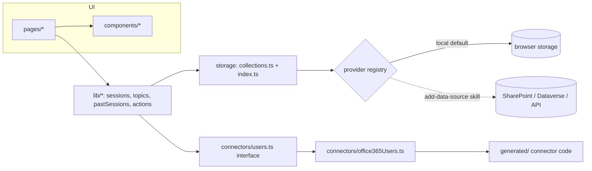

# Learning Hub

> **Preview:** Copilot Managed Runtime is in public preview. This sample and the APIs it uses may
> change. New to the platform? Start with the [Quickstart](https://go.microsoft.com/fwlink/?LinkId=2368962)
> and the [documentation](https://go.microsoft.com/fwlink/?LinkId=2372842).

A sample app hosted on Copilot Managed Runtime for running a recurring learning series: browse past
sessions and recordings, sign up to present on an upcoming date, and request and vote on topics.
It's built with React, Vite and TypeScript on the public
[`@microsoft/managed-apps`](https://www.npmjs.com/package/@microsoft/managed-apps) packages and the
`ms` CLI.

## What it demonstrates

- **A storage interface as the whole data layer.** Every read and write goes through typed
  collections (`src/storage`). Data lives in the browser by default, and you can switch to a shared
  backend (SharePoint, Dataverse, your own API) without touching UI code.
- **A connector behind an adapter.** The Office 365 Users connector (signed-in user, people search,
  profiles and photos) is wrapped in `src/connectors/office365Users.ts`; the rest of the app and
  every test use the `UsersDirectory` interface.
- **Conflict-safe, optimistic updates** with TanStack Query: votes and detail edits update
  instantly and roll back with a message on failure; sign-ups re-check fresh data and use
  version-checked writes (`ConflictError`) so two people can't claim the same date.
- **Hash routing with deep links** that survive being embedded in a host page (`?page=` links,
  reload memory) and share links that work locally and when deployed.

## Architecture



| Path | Purpose |
|---|---|
| `src/pages/` | Routes: Home, Present (sign-ups and session management), Topics, Session detail, Person, Settings and data |
| `src/lib/` | Domain logic and hooks (no direct storage or connector access outside the interfaces) |
| `src/storage/collections.ts` | zod schemas for `sessions`, `topics` and `pastSessions` |
| `src/storage/index.ts` | `createStorage()` and the provider registry selected by `VITE_STORAGE_PROVIDER` |
| `src/storage/core/` | Shared storage core (providers, queries, export/import, React hooks). Don't edit. |
| `src/connectors/` | Connector and host SDK adapters; the only code that imports `generated/` or the SDK |
| `src/config.ts` | Typed configuration from `VITE_*` variables |

## Prerequisites

- Node.js 24.11 or later and npm
- Git 2.27 or later
- A work account that can create apps in a Power Platform environment and use the
  **Office 365 Users** connector

## Setup

These steps mirror the setup skill in `.github/skills/setup-learninghub/SKILL.md`, which a coding
agent can follow for you ("set up this app"). For AI-assisted setup you can optionally install this
repository's agent plugin from [`../../plugins/microsoft-managed-apps`](../../plugins/microsoft-managed-apps).

The sample doesn't include `ms.config.json` or connector code; the steps below create them for your
app. Your app gets its own platform-managed git repository, and you commit everything to it except
`.env.local`.

1. Copy the sample into its own folder. It becomes your app's repository, so it can't stay inside a
   clone of this samples repository:

   ```sh
   git clone --depth 1 https://github.com/microsoft/Managed-Apps
   cp -r Managed-Apps/samples/LearningHub my-learninghub   # PowerShell: Copy-Item -Recurse Managed-Apps/samples/LearningHub my-learninghub
   cd my-learninghub
   ```

2. Install dependencies:

   ```sh
   npm install
   ```

3. Sign in to the CLI:

   ```sh
   npx ms auth login
   ```

4. Create the app. This creates the app, its platform-managed git repository (set up as `origin`)
   and `ms.config.json`; add `--environment-id <id>` to pick an environment:

   ```sh
   npx ms app init --display-name "Learning Hub"
   ```

5. Hide the host header (the app draws its own top bar):

   ```sh
   npx ms app set-setting --show-header false
   ```

6. Add the Office 365 Users connector (required; it generates `generated/` and `.ms/`, which you
   commit with the app):

   ```sh
   npx ms app add data-source --connector shared_office365users --as action
   ```

7. Configure the app (optional; every value has a default):

   ```sh
   cp .env.example .env.local
   ```

8. Verify and run:

   ```sh
   npm run check-setup
   npm run dev          # or: npx ms app dev
   ```

   Open the **Local Play** URL that the dev server prints to run the app inside the player with
   the live connector.

9. Commit and push to your app's repository (git asks you to sign in the first time), then deploy
   from the pushed commit:

   ```sh
   git fetch origin
   git reset origin/main   # start from the new repository's initial commit; your files stay as they are
   git branch -M main
   git add -A
   git commit -m "Set up Learning Hub"
   git push -u origin main
   npm run build && npx ms app deploy
   ```

`npm run dev` and `npm run build` run `check-setup` first and stop with these steps if one is
missing. `npm test` and `npm run lint` work right after `npm install`.

## Storage modes, data and privacy

| Mode | `VITE_STORAGE_PROVIDER` | Who sees the data |
|---|---|---|
| Local (default) | `local` | Only the current browser profile. A "Local mode" notice is shown. |
| Shared | e.g. `sharepoint`, `dataverse` (added with the skill) | Everyone with access to the backend, governed by its permissions |

What is stored:

- **sessions**: date, status (claimed or cancelled), title, description, presenters (directory
  user id plus a display-name snapshot), owner user id, linked topic id
- **topics**: title, details, requester user id, status, voter user ids, linked session date
- **pastSessions**: date, title, presenters, recording and resource links, tags, duration
- **preferences**: theme, plus small app flags (whether sample data was added, last route)

Emails are never stored. Names, job titles and photos are fetched from the directory through the
Office 365 Users connector when shown, and cached only in memory.

**Settings and data** (gear icon) lets each user **export** everything as a JSON file and
**import** it again, for backups or for moving from local mode to a shared backend.

On first run in local mode the app adds a few **obviously fictional sample sessions** (marked
"Sample", with `example.com` links). Remove them with one click on the home page or in Settings;
they won't be added again. Set `VITE_SEED_SAMPLE_DATA=false` to skip them entirely.

To share data between people, follow `.github/skills/add-data-source/SKILL.md`. In local mode
everyone manages their own copy, so any user can edit, cancel or release any session. With a shared
backend, decide who may change what in the backend's permissions; the browser is never a security
boundary.

## Configuration

All variables are optional. See `.env.example` for the full list with comments.

| Variable | Default | Purpose |
|---|---|---|
| `VITE_APP_NAME` | `Learning Hub` | Name in the top bar and tab title |
| `VITE_SERIES_NAME` | `Learning Series` | Home page heading |
| `VITE_SERIES_DESCRIPTION` | (generic sentence) | Text under the heading |
| `VITE_SERIES_WEEKDAY` | `4` (Thursday) | Day of the week, 0 = Sunday |
| `VITE_SERIES_START_TIME` / `VITE_SERIES_END_TIME` | `09:00` / `10:00` | Session time (24-hour) |
| `VITE_SERIES_TIME_ZONE` | `America/Los_Angeles` | IANA time zone for dates and times |
| `VITE_SERIES_END_DATE` | (none) | Last date of the series, `yyyy-mm-dd` |
| `VITE_SERIES_WEEKS_AHEAD` | `12` | Upcoming weeks listed when there's no end date |
| `VITE_SERIES_SKIP_DATES` | (none) | Comma-separated holiday weeks |
| `VITE_STORAGE_PROVIDER` | `local` | Storage provider key in `src/storage/index.ts` |
| `VITE_APP_STORAGE_PREFIX` | `learninghub` | Prefix for this app's browser storage keys |
| `VITE_SEED_SAMPLE_DATA` | `true` | Add fictional sample sessions on first run |
| `VITE_PUBLIC_APP_URL` | (derived) | Public https URL used for share links |

## Customization

- **Branding:** set the variables above; replace `public/favicon.svg` and `BrandMark` in
  `src/components/TopBar.tsx`; adjust colors in `src/styles/tokens.css`.
- **Data shape:** change the zod schemas in `src/storage/collections.ts`, then update the domain
  functions in `src/lib/`. Run `npm run storage:describe` to see the resulting schema.
- **Another backend:** use the add-data-source skill; register the provider in
  `src/storage/index.ts`.
- **Another directory:** implement `UsersDirectory` (`src/connectors/users.ts`) and pass it to
  `UsersDirectoryContext.Provider` in `src/main.tsx`.

## Scripts

| Script | What it does |
|---|---|
| `npm run dev` | `check-setup`, then the Vite dev server; open the "Local Play" URL it prints to run the app in the player (`npx ms app dev` does the same) |
| `npm run build` | `check-setup`, `tsc -b`, `vite build` |
| `npm run typecheck` | `tsc -b` (needs the generated connector code) |
| `npm test` | Vitest unit tests (no connector code needed) |
| `npm run lint` | ESLint, including the storage and connector boundary rules |
| `npm run check-setup` | Checks `ms.config.json` and the generated Office 365 Users code |
| `npm run storage:describe` | Prints every collection as JSON Schema |
| `npm run preview` | Serves the production build locally |

## License

MIT. See the [LICENSE](../../LICENSE) file at the root of this repository.
