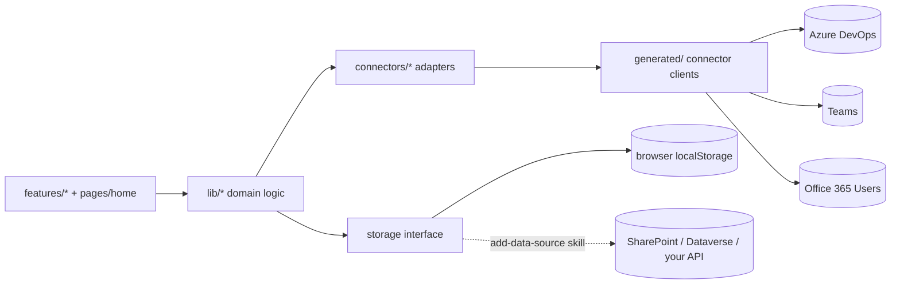

# Task Manager

> **Preview:** Copilot Managed Runtime is in public preview. Features and the `ms` CLI may change.
> Start with the [Quickstart](https://go.microsoft.com/fwlink/?LinkId=2368962) and the
> [documentation](https://go.microsoft.com/fwlink/?LinkId=2372842).

A team work board over **Azure DevOps**, styled like Windows 95: a sample app hosted on
Copilot Managed Runtime. It is a React + Vite + TypeScript single-page app that talks to Azure DevOps, Teams and Office 365 Users through connectors and keeps its own
data behind a small, swappable storage interface.

## What it does

| Tab | What you get |
|---|---|
| **My Work** | Work items assigned to you (matched by your Azure DevOps identity), their nested tasks, and your bugs. Multi-select and bulk state/tag changes. |
| **Board** | Engineers (assigned work) above, backlog categories below. Drag and drop to reassign, re-rank or move between categories; filter by title, description or tag; maximize any window. |
| **Trackers** | Saved views over every work item carrying chosen tags, organized into scenarios, with notes, combined rows, issue links and a copy-as-table export. |
| **Triage** | Items outside the configured categories (with one-click rerouting) and recently created work. Create new work items. |
| **Completed** *(admin)* | Work completed in the last six months, grouped by engineer (read-only). |
| **Retrospective** *(admin)* | A three-column retro board. |
| **Feedback** | Feature requests and bug reports about the app itself. |
| **Tags** *(admin)* | Which Azure DevOps tags the app knows about, their labels and card markers. |
| **Bulk edit** *(admin)* | Promote every item with a given tag to the top of the stack rank. |

Every edit to a work item is a real Azure DevOps write: the UI updates optimistically, refetches on
success and rolls back with Azure DevOps' own error message on failure. Azure DevOps permissions
decide what each user may change; `admins.json` only decides which tabs are shown.

**Teams showcase:** "Request ETA" sends the assignee a Teams chat message (from the connector's bot)
after showing you the exact text and asking for confirmation. The text comes from
`VITE_ETA_MESSAGE_TEMPLATE`.

## Architecture

```
src/
  pages/home.tsx         thin shell: title bar, tab strip, active tab, shared dialogs
  features/<tab>/        one folder per tab (board, my-work, trackers, triage, completed,
                         retro, feedback, tags, bulk-edit) plus work-items/ (details window,
                         context menu, write path), settings/ and shell/
  lib/                   domain logic: ado.ts (WIQL, hydration, writes), tag-config, trackers,
                         tracker-scenarios, retro-notes, work-item-notes, feedback, teams, ...
  connectors/            app-owned adapters over the generated connector clients
                         (azureDevOps.ts, teams.ts, office365Users.ts); the ONLY importers of generated/
  storage/
    core/                shared storage interface + local/memory providers (do not edit)
    collections.ts       this app's collections as zod schemas
    index.ts             createStorage(): provider registry keyed by VITE_STORAGE_PROVIDER
  config.ts              typed configuration from VITE_* variables
```



Tests replace the connector adapters with fakes and storage with the in-memory provider, so
`npm test` and `npm run lint` run on a fresh clone without any generated code.

## Prerequisites

- Node.js 24.11 or later and npm
- A Power Platform environment where you can create apps on Copilot Managed Runtime
- An Azure DevOps organization and project you can read (and write, to edit work items)
- The Teams and Office 365 Users connectors available in that environment

## Setup

The setup skill at [`.github/skills/setup-taskmanager/SKILL.md`](.github/skills/setup-taskmanager/SKILL.md)
(mirrored in `.claude/skills/`) walks a person or a coding agent through these steps. For
AI-assisted setup you can also install the repository's optional agent plugin at
[`../../plugins/microsoft-managed-apps`](../../plugins/microsoft-managed-apps).

Your app gets its own platform-managed git repository, and you commit everything to it except
`.env.local`.

1. **Copy the sample into its own folder.** It becomes your app's repository, so it can't stay
   inside a clone of this samples repository:
   ```bash
   git clone --depth 1 https://github.com/microsoft/Managed-Apps
   cp -r Managed-Apps/samples/TaskManager my-taskmanager   # PowerShell: Copy-Item -Recurse Managed-Apps/samples/TaskManager my-taskmanager
   cd my-taskmanager
   ```
2. **Install:** `npm install`
3. **Sign in:** `npx ms auth login` (use `npx ms auth status` / `npx ms auth switch` to pick an account)
4. **Create the app.** The template ships without `ms.config.json`. `init` creates the app, its
   platform-managed git repository (set up as `origin`) and `ms.config.json`:
   ```bash
   npx ms app init --display-name "Task Manager" --environment-id <ENVIRONMENT_ID> --icon-path ./public/task-manager-icon.png
   npx ms app set-setting --show-header false   # the app draws its own 95 title bar
   ```
5. **Add all three connectors** (each generates code into `generated/` and `.ms/`; commit them
   with the app):
   ```bash
   npx ms app add data-source --connector shared_visualstudioteamservices --as action
   npx ms app add data-source --connector shared_teams --as action
   npx ms app add data-source --connector shared_office365users --as action
   ```
   If the CLI reports actions "skipped due to your organization's connector policy", continue:
   `npm run check-setup` reports any action the app needs (for example the Azure DevOps
   `HttpRequest` action) that the policy removed. Ask your admin to allow it, or use an
   environment whose policy allows it.
6. **Configure:** copy `.env.example` to `.env.local` and set at least `VITE_ADO_ORG` and
   `VITE_ADO_PROJECT` (see the table below). Add admin usernames to `admins.json` (see [Admins](#admins)).
7. **Verify:** `npm run check-setup` (also runs automatically before `dev` and `build`).
8. **Run:** `npm run dev` (or `npx ms app dev`) starts the Vite dev server and prints a
   **Local Play** URL; open it to run the app inside the Copilot Managed Runtime player with live
   connectors.
9. **Commit and push** to your app's repository (git asks you to sign in the first time), then
   deploy from the pushed commit:
   ```bash
   git fetch origin
   git reset origin/main   # start from the new repository's initial commit; your files stay as they are
   git branch -M main
   git add -A
   git commit -m "Set up Task Manager"
   git push -u origin main
   npm run build && npx ms app deploy
   ```

Until an organization and project are configured, the app shows a setup screen instead of guessing.
You can also enter them for one browser in **Settings** (the gear in the title bar).

## Admins

`admins.json` (in this sample's folder, next to `package.json`) lists the usernames — sign-in UPN or email, case-insensitive — that
see the admin tabs: **Completed**, **Retrospective**, **Tags** and **Bulk edit**. It ships empty, so
nobody sees them until you add names, e.g. `{ "admins": ["avery@contoso.example"] }`, and rebuild.
An invalid file is treated as an empty list.

This is a UI convenience, **not a security boundary**: the list is compiled into the browser bundle,
and Azure DevOps permissions (and your storage backend's permissions) still decide what anyone can
change.

## Connectors and permissions

| Connector (api-id) | Used for | Operations |
|---|---|---|
| Azure DevOps (`shared_visualstudioteamservices`) | Reading and editing work items | REST passthrough (WIQL queries, batch reads, JSON-Patch updates, delete to the recycle bin), create work item, update work item, add link, list work items, list project members |
| Teams (`shared_teams`) | "Request ETA" chat message | Post message in a chat with the bot |
| Office 365 Users (`shared_office365users`) | Who is signed in; profile photos | My profile, user photo metadata, user photo |

Each user signs in to the connectors with their own account, so they can only see and change what
their Azure DevOps, Teams and Office 365 permissions allow. Every connector call goes through
`src/connectors/*`; add operations there (and to `scripts/check-setup.mjs`) if you extend the app.

## Storage modes and privacy

Work items always live in Azure DevOps; the app never stores them. The app's **own** data — retro
notes, trackers and scenarios, tag configuration, work-item notes and feedback — goes through the
storage interface in `src/storage/`:

- **`local` (default):** stored in this browser's `localStorage` under the `taskmanager:` prefix. It is
  private to the browser profile and is not shared with teammates. The title bar shows
  "Local mode: data stays in this browser".
- **Shared:** follow [`.github/skills/add-data-source/SKILL.md`](.github/skills/add-data-source/SKILL.md)
  to add a SharePoint, Dataverse or custom-API provider and set `VITE_STORAGE_PROVIDER`. Configure the
  backend's permissions; the UI is not a security boundary. `npm run storage:describe` prints every
  collection as JSON Schema (`-- --markdown` for a table).
- **Move data:** Settings › Data › Export / Import.

Profile photos and names are fetched on demand and cached in memory only. Nothing is sent to any
service other than the three connectors above.

## Configuration

All values are optional except the first two. They are compiled into the browser bundle, so never put
secrets in them.

| Variable | Default | Purpose |
|---|---|---|
| `VITE_ADO_ORG` | — | Azure DevOps organization |
| `VITE_ADO_PROJECT` | — | Azure DevOps project |
| `VITE_ADO_AREA_PATH` | project root | Area path to load (recursive) |
| `VITE_ADO_AREAS` | none | Sub-areas shown as coloured backlog columns, comma-separated |
| `VITE_ADO_BOARD_WORK_ITEM_TYPES` | `User Story,Feature,Epic` | Types shown on the board |
| `VITE_ADO_STORY_TYPE` / `VITE_ADO_BUG_TYPE` / `VITE_ADO_TASK_TYPE` | `User Story` / `Bug` / `Task` | Types created by the app |
| `VITE_ADO_EXCLUDED_STATES` | `Closed,Removed` | States hidden from the board |
| `VITE_ADO_COMPLETED_STATES` | `Closed` | States listed on the Completed tab |
| `VITE_TEAM_MEMBERS` | none | Names that always get an Engineers column |
| `VITE_APP_URL` | current page | https URL of the deployed app, used in shared links |
| `VITE_ISSUE_TRACKER_BASE_URL` | any https URL | Required prefix for tracker issue links |
| `VITE_ETA_MESSAGE_TEMPLATE` | built-in | Teams message; placeholders `{assignee} {requester} {id} {title} {link}` |
| `VITE_STORAGE_PROVIDER` | `local` | Storage provider id from `src/storage/index.ts` |
| `VITE_APP_STORAGE_PREFIX` | `taskmanager` | Browser storage key prefix |

## Scripts

| Script | What it does |
|---|---|
| `npm run dev` | Vite dev server (runs `check-setup` first) |
| `npm run build` | Type-check and production build (runs `check-setup` first) |
| `npm run preview` | Serve the production build |
| `npm run lint` | ESLint, including the storage and connector boundary rules |
| `npm run typecheck` | TypeScript (needs `generated/`, i.e. after setup) |
| `npm test` | Vitest unit tests (no setup needed) |
| `npm run check-setup` | Verify `ms.config.json` and the generated connector services |
| `npm run storage:describe` | Print the app's collections as JSON Schema |

## Customizing

- Theme and the Win95 skin: see [THEMING.md](THEMING.md).
- Work-item states, colours and descriptions: `src/lib/work-items-data.ts`.
- Card markers for tags: configured in the app's **Tags** tab.
- New app data: add a zod schema and collection in `src/storage/collections.ts`.

## License

This sample is licensed under the MIT License; see [LICENSE](../../LICENSE).
